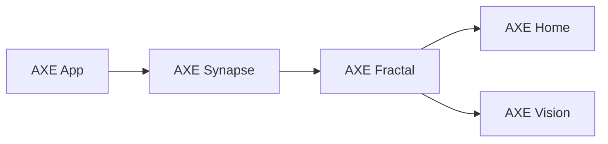

# AXE Program

AXE Program est un projet personnel à long terme : construire, brique par brique, un assistant personnel complet. D'abord sous forme d'application, puis capable de comprendre la voix et d'agir sur mes appareils, et enfin de prendre une forme physique.

Le projet est découpé en **divisions**. Chacune a son propre objectif et sert de base à la suivante : AXE App prépare AXE Synapse, qui prépare AXE Fractal, qui prépare à son tour AXE Home et AXE Vision.

## Les divisions

| Division | Rôle | Statut |
| --- | --- | --- |
| **AXE App** | Application de productivité personnelle : habitudes, flashcards, cahiers, agenda, statistiques | En cours |
| **AXE Synapse** | LLM + reconnaissance vocale : transformer ma voix en commandes et opérer dans AXE, puis sur mon PC et mon téléphone | Prévu |
| **AXE Fractal** | Boîtier connecté (micro, haut-parleur, capteurs de température, d'humidité…) : première implémentation physique d'AXE | Prévu |
| **AXE Home** | Système domotique de la maison, construit sur la base technique d'AXE Fractal | Prévu |
| **AXE Vision** | Lunettes connectées à AXE, construites sur la base technique d'AXE Fractal, pour qu'AXE soit constamment avec moi | Prévu |



## Nomenclature

Chaque version suit le même nom : **AXE**, puis le **produit**, puis le **numéro de version** de ce produit.

| Exemple | Signification |
| --- | --- |
| AXE App 2 | 2e version d'AXE App (flashcards) |
| AXE Synapse 1 | 1re version d'AXE Synapse (commande vocale) |
| AXE Fractal 1 | 1re version du boîtier AXE Fractal |

La numérotation repart à 1 pour chaque produit : on ne dit pas « AXE 2 » mais « AXE App 2 ».

## AXE App

AXE App est la première division et le socle de tout le reste. C'est une application de productivité personnelle conçue pour organiser mes habitudes, mes révisions et mon temps, et suivre ma progression.

Elle a deux objectifs :

* Développer mes compétences en code
* Apprendre la conception concrète d'une application, de la première fonctionnalité jusqu'au déploiement

Le développement est progressif : chaque fonctionnalité est construite lorsque le besoin apparaît, afin de garder une architecture claire, maintenable et évolutive. L'application évolue d'un front-end local vers une application complète avec serveur, puis vers une application de bureau.

---

# Technologies utilisées

## Front-end

* HTML5
* JavaScript ES6 Modules
* SCSS
* npm
* LocalStorage (stockage actuel)

## Librairies

* Chart.js (graphique hebdomadaire du dashboard, futures statistiques)
* Quill (éditeur de texte riche des flashcards)
* DOMPurify (nettoyage de HTML, chargé mais pas encore utilisé)
* Faker (développement uniquement : génération de flashcards de test)

## Outils

* VS Code
* Git / GitHub
* Sass

---

# Architecture du projet

```
src
├── assets
├── font
├── js
│   ├── components
│   │   ├── calendar
│   │   ├── dashboard
│   │   ├── habits
│   │   │   └── popupSearch
│   │   ├── scolar
│   │   └── theme
│   ├── services
│   ├── testData
│   └── utils
└── scss
    ├── abstracts
    ├── base
    ├── components
    │   ├── calendar
    │   ├── dashboard
    │   ├── graph
    │   ├── habitManager
    │   └── scolar
    └── layout
```

| Dossier | Rôle |
| --- | --- |
| `assets` | Images et icônes (vide pour l'instant) |
| `font` | Polices du projet (Inter, Frick Condensed) |
| `js` | `main.js` (point d'entrée de toutes les pages) et `debug.js` |
| `js/components` | Une fonctionnalité par dossier, découpée en logique / UI / events |
| `js/components/calendar` | Calendrier (préparé pour AXE App 4) |
| `js/components/dashboard` | Tableau de bord : habitudes du jour, streaks, graphique de la semaine |
| `js/components/habits` | Gestionnaire d'habitudes : création, modification, suppression, recherche |
| `js/components/scolar` | Flashcards et dossiers (AXE App 2), éditeur de texte Quill |
| `js/components/theme` | Bascule mode clair / mode sombre |
| `js/services` | Accès aux données (localStorage), sans lien avec l'interface |
| `js/testData` | Jeu de dossiers et de flashcards de test (non chargé par défaut) |
| `js/utils` | Fonctions réutilisables : DOM, dates, formats, effets, popups d'erreur |
| `scss` | `main.scss` importe toutes les feuilles de style |
| `scss/abstracts` | Variables CSS (couleurs, espacements…) du thème clair et du thème sombre |
| `scss/base` | Styles de base de la page (reset, typographie) |
| `scss/components` | Styles des composants, un sous-dossier par fonctionnalité |
| `scss/layout` | Header, footer et mise en page générale |

---

# Organisation du code

## Components

Contient les fonctionnalités principales de l'application.

Exemple :

* `components/habits` : gestionnaire d'habitudes
* `components/dashboard` : affichage du tableau de bord
* `components/scolar` : flashcards et dossiers (gestion scolaire)
* `components/calendar` : calendrier
* `components/theme` : bascule mode clair / mode sombre

---

## Services

Contient les services indépendants de l'interface.

Actuellement, un fichier par domaine dans `services/storage/` :

* `storageHabits.js` : habitudes
* `storageFlashcards.js` : flashcards
* `storageFolders.js` : dossiers et navigation dans l'arborescence
* `storageTheme.js` : préférence de thème
* `storageSize.js` : outil de debug (taille du localStorage)

Responsabilités :

* Sauvegarde des données (habitudes, flashcards, dossiers, préférence de thème)
* Récupération des données
* Suppression des données
* Navigation dans l'arborescence des dossiers (sous-dossiers, chemin, déplacement)

---

## Test data

`testData/testData.js` crée un jeu de dossiers et de flashcards de test (marqués `isTest`, pour pouvoir les retirer sans toucher aux vraies données). Le module n'est pas chargé par défaut : il faut l'importer dans `main.js` pour l'utiliser.

---

## Utils

Contient les fonctions utilitaires réutilisables.

Exemples :

* Protection des sélecteurs DOM
* Conversion des formats
* Gestion des dates
* Effets visuels (compteurs animés, confettis)

---

## Styles

Les styles sont écrits en SCSS dans `src/scss/` et compilés dans `public/css/style.css` (fichier généré, à ne pas modifier à la main).

Couleurs, espacements, rayons et ombres sont des variables CSS définies dans `abstracts/_tokens.scss`, redéfinies pour le mode sombre. Les conventions détaillées sont décrites dans `skill.md`.

---

# Système de debug

AXE possède un système de debug, défini dans `debug.js`.

Chaque fichier crée sa propre fonction de debug, avec un niveau local :

```javascript
import { createDebug } from "../../debug.js";

const LOCAL_DEBUG = true;
const debug = createDebug(LOCAL_DEBUG);

debug("Message de debug");
```

Les logs s'affichent si le debug local du fichier est actif, ou si le debug global (`AXE.DEBUG` dans `debug.js`) l'est. La console indique le fichier et la ligne d'origine de chaque log.

Cela permet d'activer ou désactiver facilement les logs pendant le développement.

---

# Roadmap

## AXE App (AXE App 1 → AXE App 6)

### AXE App 1 - Habit Manager

**Statut :** terminé

Objectif : Finaliser le système complet de gestion des habitudes.

Fonctionnalités :

* Création d'habitudes
* Modification d'habitudes
* Suppression d'habitudes
* Affichage dynamique des habitudes
* Système de suivi quotidien
* Gestion des séries (streaks)
* Amélioration UX/UI

### AXE App 2 - Flashcards

**Statut :** en cours

Objectif : Centraliser les révisions dans AXE.

Fonctionnalités terminées :

* Création, modification et suppression de flashcards
* Classification des flashcards dans des dossiers et sous-dossiers (arborescence sans limite de profondeur)
* Création, renommage et suppression de dossiers
* Navigation dans les dossiers : flèches précédent / suivant (historique) et fil d'Ariane

Prochaines fonctionnalités :

* Sélection multiple de dossiers et de flashcards (clic, Ctrl+clic, Échap pour désélectionner)
* Couper / coller de dossiers et de flashcards (déplacement dans l'arborescence)
* Copier / coller de dossiers et de flashcards (copie récursive des sous-dossiers, avec de nouveaux identifiants)
* Glisser-déposer de la sélection vers un dossier de la grille ou du fil d'Ariane
* Raccourcis clavier : Ctrl+C, Ctrl+X, Ctrl+V, Suppr
* Session de révision lancée sur un dossier ou une sélection de flashcards
* Impression des flashcards (d'une carte, d'un dossier ou d'une sélection)

Points à régler :

* Choisir le comportement du clic (sélectionner ou ouvrir) quand la sélection multiple arrivera
* Nettoyer l'historique de navigation quand un dossier qu'il contient est supprimé ou déplacé

### AXE App 3 - Cahiers

Objectif : Centraliser les cours dans AXE, avec un CRUD complet des cahiers.

Fonctionnalités :

* Création, modification et suppression de cahiers, avec choix du type de page : grands carreaux ou petits carreaux
* Ajout de chapitres dans un cahier
* Fenêtre d'édition de texte en Markdown
* Rendu du Markdown sur un cahier virtuel, consultable facilement
* Hiérarchisation automatique à partir des titres Markdown :
  * Thème
  * Chapitre
  * Grandes parties (I, II, III…)
  * Sous-parties (A, B, C…)
  * Activité ou autre
  * Textes / leçon / bilan
* Ajout d'images et de documents (documents fournis par le professeur, scannés)

### AXE App 4 - Agenda & Organisation

Objectif : Ajouter une gestion complète du temps.

Fonctionnalités :

* Calendrier avancé
* Planning quotidien
* Évènements
* Rappels
* Organisation des tâches
* Connexion entre habitudes et agenda

### AXE App 5 - Statistiques & Progression

Objectif : Transformer les données d'AXE en informations exploitables.

Fonctionnalités :

* Statistiques personnelles
* Graphiques de progression
* Historique des habitudes
* Calcul des performances
* Analyse des séries
* Visualisation des objectifs

### AXE App 6 - Serveur & application de bureau

Objectif : Faire d'AXE une application complète, avec ses données sur un serveur, puis installable sur ordinateur. La mise à jour se fait en deux parties.

#### Partie 1 - Serveur

* Création d'un backend et d'une API REST
* Migration des données du localStorage vers une base de données
* Authentification et gestion du compte
* Synchronisation des données entre appareils
* Hébergement du serveur
* Sécurité des données

Technologies envisagées : Node.js, base de données SQL ou NoSQL, API REST.

#### Partie 2 - Application de bureau

* Migration du front-end vers Electron
* Installation d'AXE comme application de bureau
* Accès au système de fichiers local (import d'images et de documents scannés, export)
* Notifications natives du système
* Connexion au serveur

Technologies envisagées : Electron, Node.js.

À la fin d'AXE App 6, AXE App est terminée et sert de base à AXE Synapse : l'API du serveur devient l'ensemble des commandes que l'IA pourra exécuter.

---

## AXE Synapse (AXE Synapse 1 → …)

Objectif : Passer d'une application à un assistant intelligent, capable de comprendre ma voix et d'agir à ma place.

### AXE Synapse 1 - Commande vocale

Fonctionnalités :

* Reconnaissance vocale (voix → texte)
* Connexion d'un LLM à AXE
* Transformation d'une demande en commandes AXE (créer une habitude, une flashcard, un évènement…)
* Exécution des commandes directement dans AXE

### Étapes suivantes

* Opérer sur mon PC
* Opérer sur mon téléphone

AXE Synapse sert de base à AXE Fractal : c'est elle qui donne au boîtier sa capacité à comprendre et à agir.

---

## AXE Fractal

Objectif : Créer un petit boîtier hardware, première implémentation physique d'AXE.

Équipement envisagé :

* Micro
* Haut-parleur
* Capteur de température
* Capteur d'humidité
* Autres capteurs

AXE Fractal sert de base technique à AXE Home et à AXE Vision.

---

## AXE Home

Objectif : Mettre en place un système domotique dans ma maison, basé sur AXE Fractal.

---

## AXE Vision

Objectif : Créer des lunettes connectées à AXE, pour qu'AXE soit constamment avec moi.

Équipement envisagé (première version) :

* Haut-parleur à conduction osseuse
* Micro
* Antenne

---

# Philosophie de développement

AXE suit plusieurs principes :

* Construire uniquement ce qui est nécessaire
* Éviter la complexification prématurée
* Garder une architecture compréhensible
* Séparer clairement les responsabilités
* Améliorer progressivement la qualité du code

Le projet évolue par itérations successives :
fonctionnalité → utilisation → amélioration → refactorisation.

---

# Installation

Cloner le projet :

```bash
git clone https://github.com/Morgan-Davila/AXE-Program.git
```

Installer les dépendances :

```bash
npm install
```

Compiler les styles (ou `npm run sass:watch` pour recompiler à chaque modification) :

```bash
npm run sass
```

Lancer le projet : il n'y a pas de serveur de développement. Ouvrir `index.html` avec un serveur statique, par exemple l'extension VS Code « Live Server ».

---

# Licence

Projet personnel en développement.
